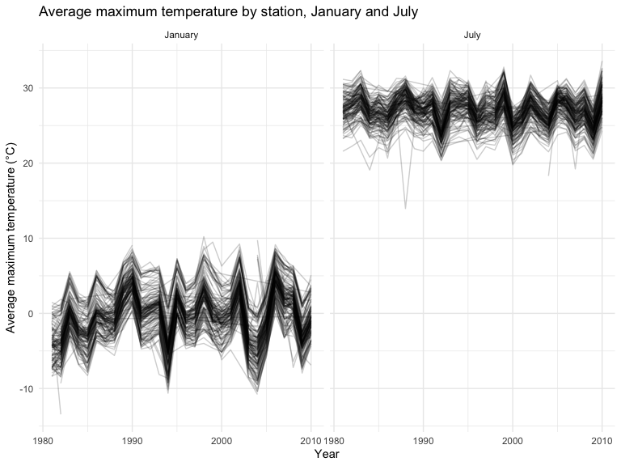
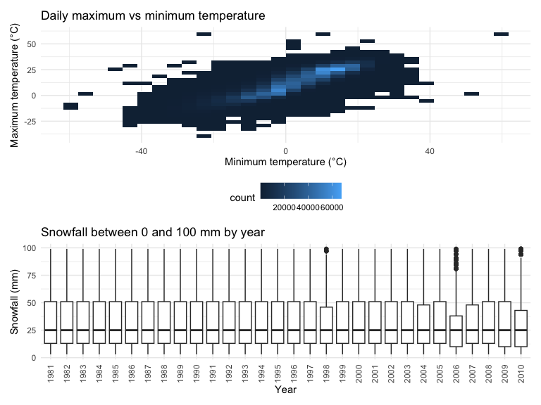
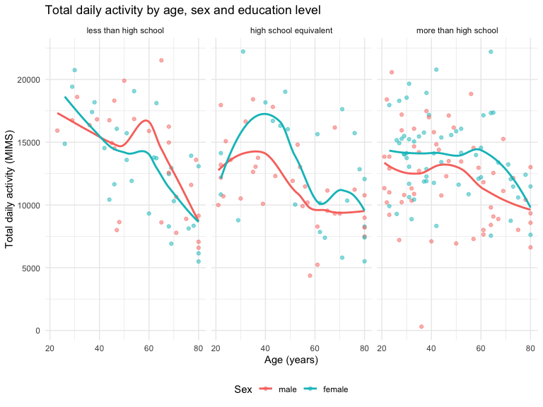
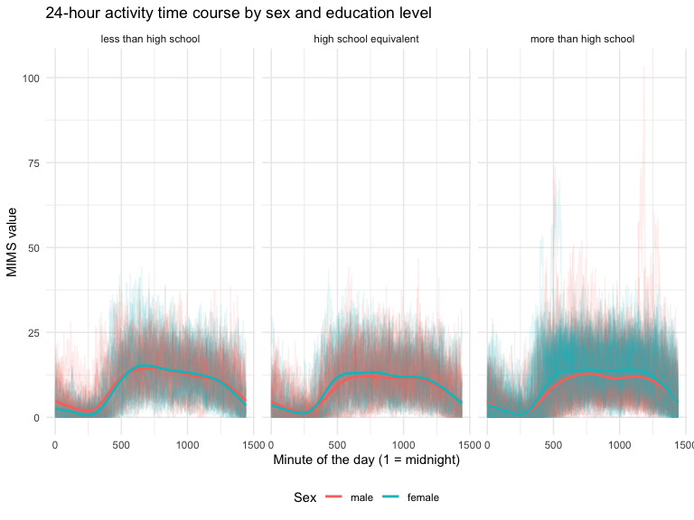
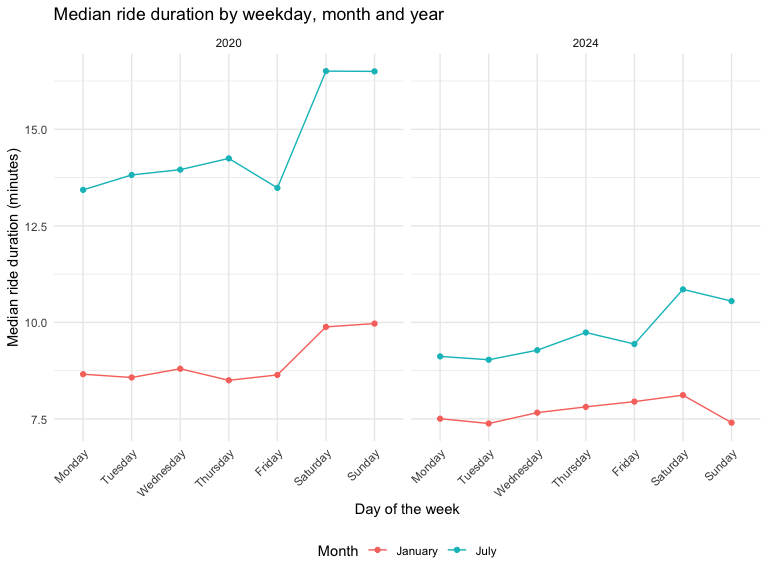
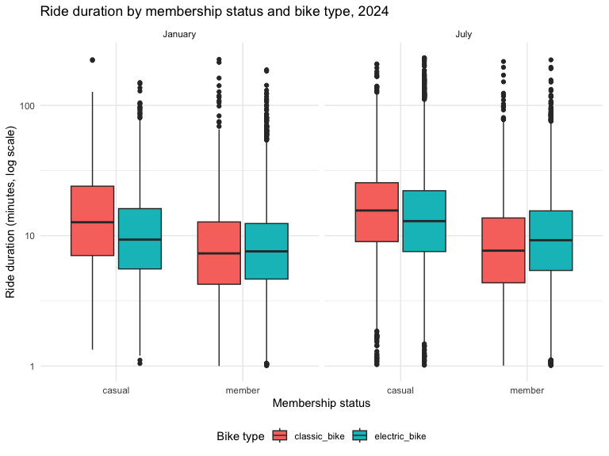

Homework 3
================
Isabella Gerlitz
2026-10-19

``` r
library(tidyverse)
library(p8105.datasets)
library(patchwork)

theme_set(theme_minimal() + theme(legend.position = "bottom"))
```

## Problem 1

``` r
data("ny_noaa")

dim(ny_noaa)
## [1] 2595176       7
glimpse(ny_noaa)
## Rows: 2,595,176
## Columns: 7
## $ id   <chr> "US1NYAB0001", "US1NYAB0001", "US1NYAB0001", "US1NYAB0001", "US1N…
## $ date <date> 2007-11-01, 2007-11-02, 2007-11-03, 2007-11-04, 2007-11-05, 2007…
## $ prcp <int> NA, NA, NA, NA, NA, NA, NA, NA, NA, NA, NA, NA, NA, NA, NA, NA, 3…
## $ snow <int> NA, NA, NA, NA, NA, NA, NA, NA, NA, NA, NA, NA, NA, NA, NA, NA, 3…
## $ snwd <int> NA, NA, NA, NA, NA, NA, NA, NA, NA, NA, NA, NA, NA, NA, NA, NA, 0…
## $ tmax <chr> NA, NA, NA, NA, NA, NA, NA, NA, NA, NA, NA, NA, NA, NA, NA, NA, N…
## $ tmin <chr> NA, NA, NA, NA, NA, NA, NA, NA, NA, NA, NA, NA, NA, NA, NA, NA, N…

ny_noaa |> 
  summarize(across(everything(), ~ mean(is.na(.x))))
## # A tibble: 1 × 7
##      id  date   prcp  snow  snwd  tmax  tmin
##   <dbl> <dbl>  <dbl> <dbl> <dbl> <dbl> <dbl>
## 1     0     0 0.0562 0.147 0.228 0.437 0.437
```

The dataset has 2,595,176 observations and 7 variables. Every row
represents one weather station on one day. The variables are `id`
(station), `date`, `prcp` (precipitation), `snow` (snowfall), `snwd`
(snow depth), `tmax` and `tmin` (maximum and minimum temperature). There
is a lot of missing data because many of the stations don’t record each
variable every day.

``` r
noaa_df = 
  ny_noaa |> 
  mutate(
    year = year(date),
    month = month(date),
    day = day(date),
    tmax = as.numeric(tmax) / 10,
    tmin = as.numeric(tmin) / 10,
    prcp = prcp / 10
  )

noaa_df |> 
  count(snow, sort = TRUE) |> 
  slice_head(n = 5)
## # A tibble: 5 × 2
##    snow       n
##   <int>   <int>
## 1     0 2008508
## 2    NA  381221
## 3    25   31022
## 4    13   23095
## 5    51   18274
```

For snowfall the most commonly observed values are 0, NA, 25, 13, 51.
These numbers could make sense because they are inches converted into
mm.

``` r
noaa_df |> 
  filter(month %in% c(1, 7)) |> 
  group_by(id, year, month) |> 
  summarize(mean_tmax = mean(tmax, na.rm = TRUE), .groups = "drop") |> 
  drop_na(mean_tmax) |> 
  mutate(month = factor(month, levels = c(1, 7), labels = c("January", "July"))) |> 
  ggplot(aes(x = year, y = mean_tmax, group = id)) +
  geom_line(alpha = 0.2) +
  facet_grid(. ~ month) +
  labs(
    title = "Average maximum temperature by station, January and July",
    x = "Year",
    y = "Average maximum temperature (°C)"
  )
```



The average maximum temperatures are much lower in January (roughly
-10°C to 10°C) than in July (roughly 22°C to 32°C). Stations tend to
rise and fall in temperature together from year to year. There are a few
outliers, such as one very cold January station in the early 1980s and
one very cold July station in the late 1980s.

``` r
temp_p = 
  noaa_df |> 
  ggplot(aes(x = tmin, y = tmax)) +
  geom_bin2d() +
  labs(
    title = "Daily maximum vs minimum temperature",
    x = "Minimum temperature (°C)",
    y = "Maximum temperature (°C)"
  )

snow_p = 
  noaa_df |> 
  filter(snow > 0, snow < 100) |> 
  ggplot(aes(x = factor(year), y = snow)) +
  geom_boxplot() +
  theme(axis.text.x = element_text(angle = 90, vjust = 0.5)) +
  labs(
    title = "Snowfall between 0 and 100 mm by year",
    x = "Year",
    y = "Snowfall (mm)"
  )

temp_p / snow_p
## Warning: Removed 1136276 rows containing non-finite outside the scale range
## (`stat_bin2d()`).
```



Max and min temperatures are positively correlated with most
observations occurring between 0 and 25 deg. C. There are a few
extremely high observations. Snowfall has a similar distribution across
years, especially before 1998.

## Problem 2

``` r
covar_df = 
  read_csv("data/nhanes_covar.csv", skip = 4) |> 
  janitor::clean_names() |> 
  filter(age >= 21) |> 
  drop_na() |> 
  mutate(
    sex = factor(sex, levels = c(1, 2), labels = c("male", "female")),
    education = factor(
      education, 
      levels = c(1, 2, 3), 
      labels = c("less than high school", "high school equivalent", "more than high school"),
      ordered = TRUE
    )
  )

accel_df = 
  read_csv("data/nhanes_accel.csv") |> 
  janitor::clean_names()

nhanes_df = inner_join(covar_df, accel_df, by = "seqn")

dim(nhanes_df)
## [1]  228 1445
```

Using NHANES demographic and accelerometer data, I kept participants
that were 21+ with no missing demographic data, and then converted sex
and education to labeled factors. I then merged them by ID. The
resulting dataset contains 228 participants and 1445 variables (five
demographic variables and 1440 activity measures).

``` r
nhanes_df |> 
  count(education, sex) |> 
  pivot_wider(names_from = sex, values_from = n) |> 
  knitr::kable(
    caption = "Number of men and women in each education category",
    col.names = c("Education", "Male", "Female")
  )
```

| Education              | Male | Female |
|:-----------------------|-----:|-------:|
| less than high school  |   27 |     28 |
| high school equivalent |   35 |     23 |
| more than high school  |   56 |     59 |

Number of men and women in each education category

More than high school contained the most participants. Male and Female
are similar in the less than high school and more than high school
groups. There are more men in the high school equivalent group.

``` r
nhanes_df |> 
  ggplot(aes(x = sex, y = age, fill = sex)) + 
  geom_boxplot() + 
  facet_grid(. ~ education) + 
  labs(
    title = "Age distribution by sex and education level",
    x = "Sex",
    y = "Age (years)",
    fill = "Sex"
  )
```


High school equivalent females are older than the males. In more than
high school, both males and females are younger. In less than high
school, the age distribution for males and females look similar.

``` r
total_df = 
  nhanes_df |> 
  mutate(total_activity = rowSums(pick(starts_with("min")))) |> 
  select(seqn, sex, age, education, total_activity)

total_df |> 
  ggplot(aes(x = age, y = total_activity, color = sex)) + 
  geom_point(alpha = 0.5) + 
  geom_smooth(se = FALSE) + 
  facet_grid(. ~ education) + 
  labs(
    title = "Total daily activity by age, sex and education level",
    x = "Age (years)",
    y = "Total daily activity (MIMS)",
    color = "Sex"
  )
```



Across age groups, total activity declines with age. The trend line for
men and women in the less than high school group are similar. In High
school equivalent women are more active than men.

``` r
nhanes_df |> 
  pivot_longer(
    starts_with("min"),
    names_to = "minute",
    names_prefix = "min",
    values_to = "mims"
  ) |> 
  mutate(minute = as.numeric(minute)) |> 
  ggplot(aes(x = minute, y = mims, color = sex)) + 
  geom_line(aes(group = seqn), alpha = 0.1) + 
  geom_smooth(se = FALSE) + 
  facet_grid(. ~ education) + 
  labs(
    title = "24-hour activity time course by sex and education level",
    x = "Minute of the day (1 = midnight)",
    y = "MIMS value",
    color = "Sex"
  )
```



Activity is lowest overnight (between minutes 0 to 500) for all three
groups. For all three groups activity rises until midday then decreases
into the evening. Men and women appear to follow the same trends.

## Problem 3

``` r
citi_df = 
  tibble(file = list.files("data/citibike", pattern = "zip$", full.names = TRUE)) |> 
  mutate(data = map(file, read_csv, show_col_types = FALSE)) |> 
  unnest(data) |> 
  mutate(
    year = as.numeric(str_extract(file, "20[0-9]{2}")),
    month = if_else(str_detect(file, "Jan"), "January", "July"),
    month = factor(month, levels = c("January", "July")),
    weekdays = factor(
      weekdays, 
      levels = c("Monday", "Tuesday", "Wednesday", "Thursday", "Friday", "Saturday", "Sunday")
    ),
    member_casual = factor(member_casual),
    rideable_type = factor(rideable_type)
  ) |> 
  select(-file)

dim(citi_df)
## [1] 99485     9

citi_df |> count(year, month)
## # A tibble: 4 × 3
##    year month       n
##   <dbl> <fct>   <int>
## 1  2020 January 12420
## 2  2020 July    21048
## 3  2024 January 18861
## 4  2024 July    47156
```

``` r
citi_df |> 
  count(year, month, member_casual) |> 
  pivot_wider(names_from = member_casual, values_from = n) |> 
  knitr::kable(
    caption = "Total Citi Bike rides by year, month and rider type",
    col.names = c("Year", "Month", "Casual", "Member")
  )
```

| Year | Month   | Casual | Member |
|-----:|:--------|-------:|-------:|
| 2020 | January |    984 |  11436 |
| 2020 | July    |   5637 |  15411 |
| 2024 | January |   2108 |  16753 |
| 2024 | July    |  10894 |  36262 |

Total Citi Bike rides by year, month and rider type

July has many more rides than January for both years and rider types.
Members take more rides than casual riders across years and months.
Casual riders make up a bigger share in July.

``` r
citi_df |> 
  filter(year == 2024, month == "July") |> 
  count(start_station_name, sort = TRUE) |> 
  slice_head(n = 5) |> 
  knitr::kable(
    caption = "Top 5 starting stations, July 2024",
    col.names = c("Start station", "Number of rides")
  )
```

| Start station            | Number of rides |
|:-------------------------|----------------:|
| Pier 61 at Chelsea Piers |             163 |
| University Pl & E 14 St  |             155 |
| W 21 St & 6 Ave          |             152 |
| West St & Chambers St    |             150 |
| W 31 St & 7 Ave          |             146 |

Top 5 starting stations, July 2024

The top 5 stations have a similar number or rides, with the highest
being Pier 61 with 163 rides.

``` r
citi_df |> 
  group_by(year, month, weekdays) |> 
  summarize(median_duration = median(duration), .groups = "drop") |> 
  ggplot(aes(x = weekdays, y = median_duration, color = month, group = month)) + 
  geom_point() + 
  geom_line() + 
  facet_grid(. ~ year) + 
  theme(axis.text.x = element_text(angle = 45, hjust = 1)) + 
  labs(
    title = "Median ride duration by weekday, month and year",
    x = "Day of the week",
    y = "Median ride duration (minutes)",
    color = "Month"
  )
```



July has longer median ride duration than January in both years. There
was overall longer rides in 2020, possibly due to the pandemic. Weekend
rides were longer across groups except for Sundays in January 2024.

``` r
citi_df |> 
  filter(year == 2024) |> 
  ggplot(aes(x = member_casual, y = duration, fill = rideable_type)) + 
  geom_boxplot() + 
  facet_grid(. ~ month) + 
  scale_y_log10() + 
  labs(
    title = "Ride duration by membership status and bike type, 2024",
    x = "Membership status",
    y = "Ride duration (minutes, log scale)",
    fill = "Bike type"
  )
```



Casual riders took longer rides than members in both months. Casual
riders bike longer on classic bikes vs. the e-bikes. With members its
much closer. Rides are longer in July than January. These data had many
outliers so I used the log sclae.
